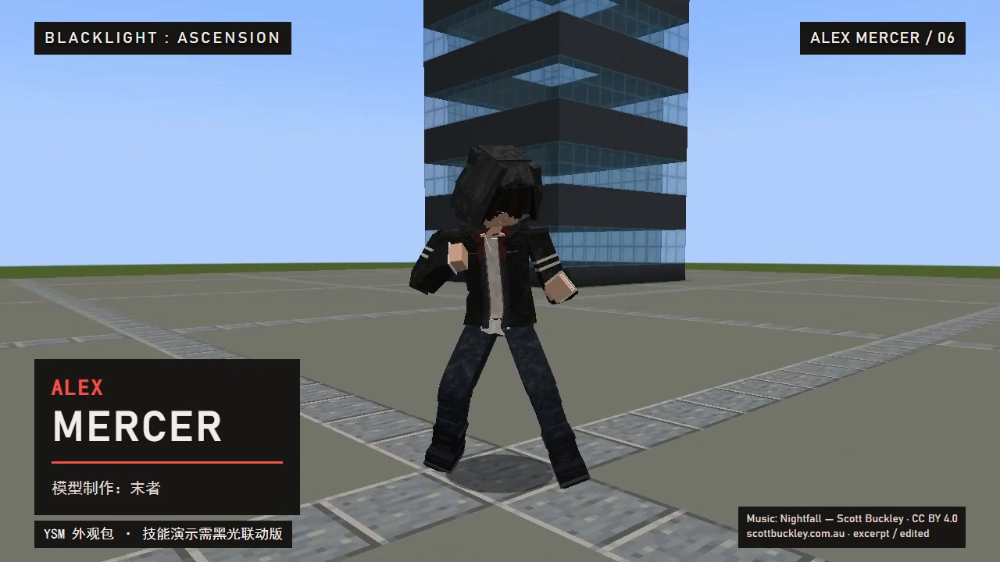

# Alex Mercer · A哥 YSM 模型

**作者：末者 · 当前版本 V4.4 · 模型许可 CC BY 4.0**

面向 Yes Steve Model（YSM）的 Alex Mercer 方块风格人物，包含兜帽、红色背纹、分层衣装、独立骨架与表情节点。本仓库公开可编辑 Blockbench 工程、贴图、YSM 模型和动画文件。



## 下载

- [模型安装包、源文件和 30 秒实机视频](https://github.com/mengyuyuan/alex-mercer-ysm/releases/tag/v4.4)
- [黑光模组](https://github.com/mengyuyuan/blacklight-evolution)

## 安装

1. 安装与你的 Minecraft／加载器版本匹配的 YSM。
2. 下载 Release 中的 `Alex-Mercer-V4.4-YSM.zip`，解压。
3. 将 `alex_mercer_blacklight` 文件夹放入该游戏实例的 `config/yes_steve_model/custom/`，按照所用 YSM 版本的方式重载模型，选择“A哥 · 黑光独立骨架 V4.4”。
4. ZIP 不是模组 JAR，不要直接放进 `mods`。

本次实机展示环境为 Minecraft 1.20.1 / Forge / YSM 2.6.5。其他组合需要单独验证，不能仅凭文件可加载就宣称兼容。

## 内容和限制

- 人物按约三格视觉高度设计；不改变玩家碰撞箱。
- 独立 35 骨骼，保留头部、眼皮、眉毛、嘴部和衣摆节点。
- 包含 273 个动画条目，其中 240 个 `blacklight_*` 条目来自黑光项目现有动作的新骨架适配；条目数不代表 273 个独立技能。
- **独立 YSM 包不会自动接收黑光技能状态。** 宣传片里的技能画面来自黑光 Mercer 原生外观适配层，并非只装本模型就能触发全部技能。
- 翅膀独立，当前包不含翅膀；专用 YSM 战甲尚未完成。
- 后脑与兜帽轮廓仍需精调，计划在下一版改善自然体积。

## 编辑和打包

`source/` 保存作者侧工程与基础动作；`model/alex_mercer_blacklight/` 是本次实际发布的模型数据，包含适配后的完整动画。需要修改当前发布模型时，优先打开该目录的 `mercer_blacklight.bbmodel`，并同步导出的模型、贴图及动画文件。

```sh
python tools/package_model.py
```

命令检查 JSON、骨骼引用、元数据指向的文件，然后生成 `dist/Alex-Mercer-V4.4-YSM.zip`。只打包仓库已有数据，不依赖完整黑光代码库，也不重新生成技能动画。

## 许可和署名

本仓库人物模型、贴图和本项目可授权的修改部分采用 [CC BY 4.0](https://creativecommons.org/licenses/by/4.0/)，允许分享和修改，包括商业使用；请保留“末者”署名、许可链接并注明修改。完整条款见 [LICENSE](LICENSE)。

建议署名：`Alex Mercer YSM 模型 — 末者，CC BY 4.0；修改：你的名字。`

角色设计参考《虐杀原形》的 Alex Mercer。本项目为同人制作，不代表游戏权利方。动作初始来源和长期修改记录见 [动作来源说明](docs/MOTION_PROVENANCE_ZH.md)，保留原有来源记录，不把来源标记当成“全部未经修改”的结论，也不因本次发布宣称全部关键帧从零原创。CC 许可仅覆盖发布者有权许可的内容，不替代第三方原有权利或许可。

宣传片音乐署名和素材说明见 [CREDITS.md](CREDITS.md)。
